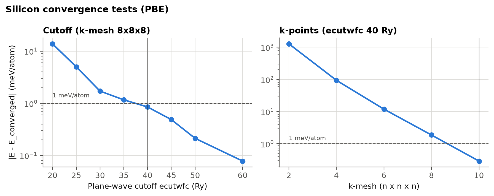
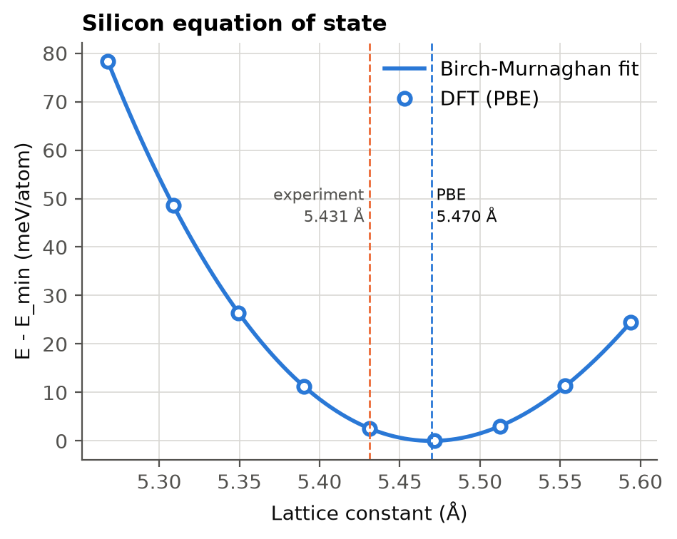
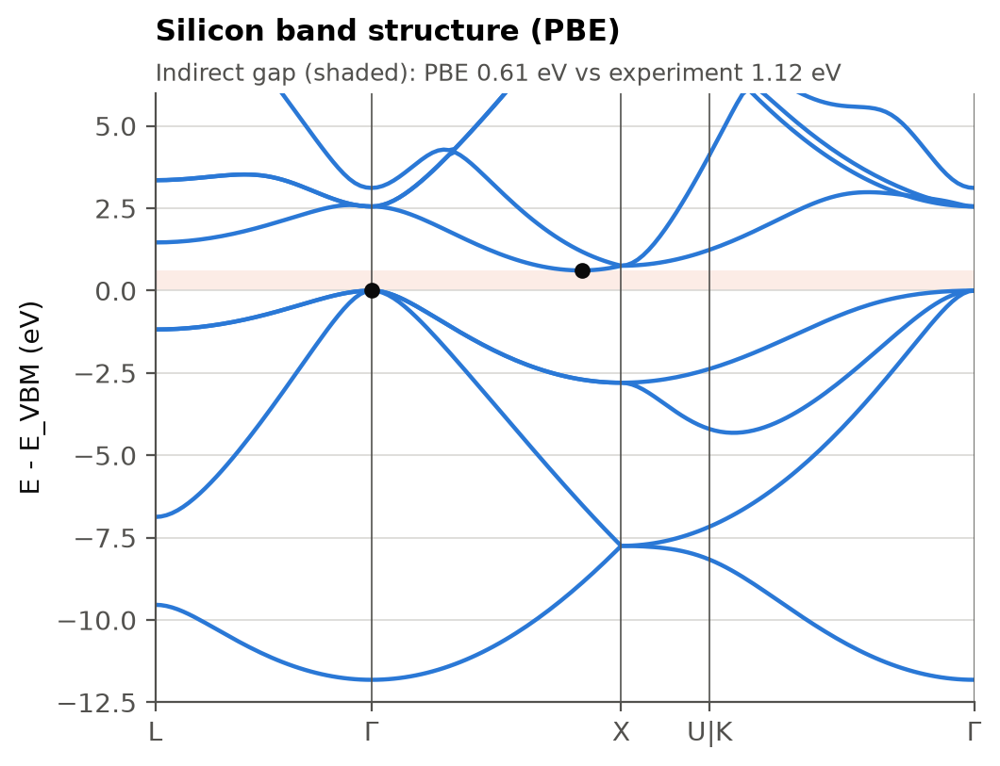
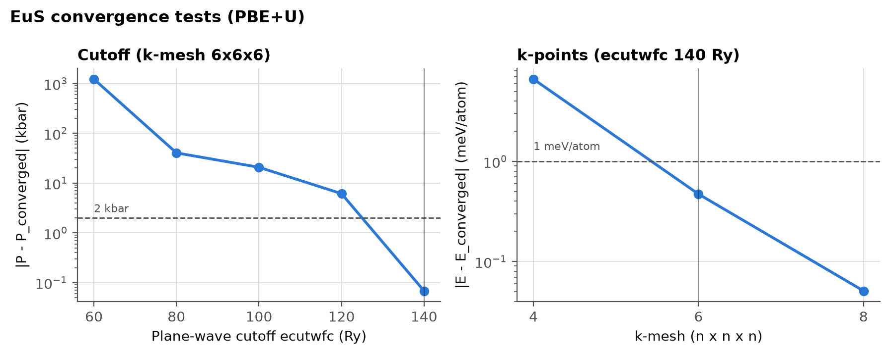
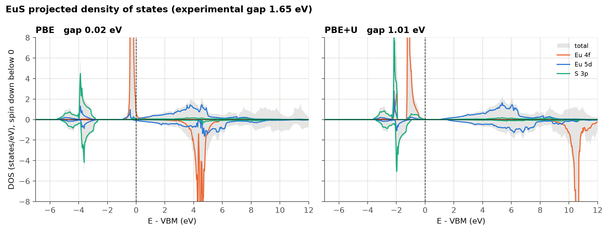
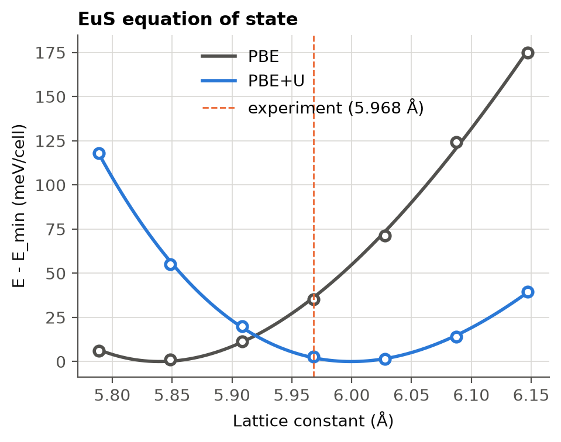
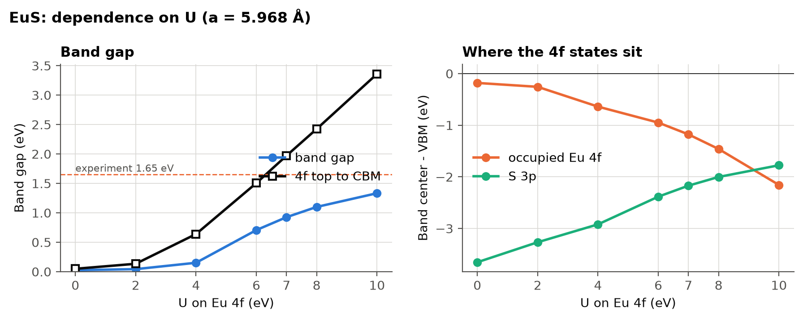

# EuS from first principles

Density functional theory (DFT) calculations of europium sulfide, a Eu²⁺ ferromagnetic semiconductor, using Quantum ESPRESSO.

My undergraduate research was on colloidal EuGdCuS₃ nanorods, where the magnetism comes from the half-filled 4f shell of Eu²⁺. This project asks what standard DFT gets right and wrong about that kind of material. The short answer for f-electron systems is that plain DFT gets it badly wrong, and the project is built around showing that failure and fixing it.

## Roadmap

| Step | What | Status |
|---|---|---|
| 1 | Convergence tests on silicon | Done |
| 2 | Silicon lattice constant and bulk modulus | Done |
| 3 | Silicon band structure | Done |
| 4 | Convergence tests on EuS | Done |
| 5 | EuS with plain PBE vs PBE+U: the 4f states land at the Fermi level, then U opens the gap; compare gap, lattice constant and moment to experiment | Done |
| 6 | How the EuS results depend on U | Done |
| 7 | Exchange constants J₁, J₂ from magnetic configurations, fed into my [Monte Carlo code](https://github.com/matthewcotaj/magnetic-ordering) to predict T_c (experiment 16.5 K) | Next |

Silicon comes first because it is cheap and well understood, so it validates the workflow before moving to a material where things can go wrong.

## Results: silicon

### Convergence

Total energy converged to 1 meV/atom at **ecutwfc = 40 Ry** and a **10×10×10 k-mesh**.



### Lattice constant

| | PBE (this work) | Experiment |
|---|---|---|
| Lattice constant | 5.470 Å | 5.431 Å |
| Bulk modulus | 88.7 GPa | 98 GPa |

PBE overestimates the lattice constant by 0.7%, the expected direction and size for this functional.



### Band structure

PBE gives an indirect gap of **0.61 eV** against the experimental 1.12 eV, with the conduction band minimum 84% of the way from Γ to X. Underestimating gaps by about half is the well-known band gap problem of semilocal DFT.



## Results: EuS

### Convergence

EuS needs far more plane waves than silicon. The Eu pseudopotential keeps 27 electrons in the valence, including the tightly bound 4d and 4f shells.

The absolute energy converges too slowly to be a useful criterion, so the cutoff is chosen by when the pressure (which sets the lattice constant) and the band gap stop changing. Tests use PBE+U with U = 7 eV.

| ecutwfc (Ry) | 60 | 80 | 100 | 120 | 140 | 160 |
|---|---|---|---|---|---|---|
| Pressure (kbar) | 1216 | 33.7 | 14.1 | -0.5 | -6.6 | -6.6 |
| Gap (eV) | 1.021 | 0.925 | 0.913 | 0.924 | 0.926 | 0.926 |

Converged at **ecutwfc = 140 Ry** (ecutrho = 4x; doubling it to 8x changes the pressure by 0.02 kbar) and a **6×6×6 k-mesh** (0.5 meV/atom from the 10×10×10 result).



### Plain PBE vs PBE+U

| | PBE | PBE+U (U = 7 eV) | Experiment |
|---|---|---|---|
| Lattice constant | 5.840 Å (-2.2%) | 6.000 Å (+0.5%) | 5.968 Å |
| Bulk modulus | 60.4 GPa | 50.1 GPa | |
| Band gap | 0.02 eV | 1.01 eV | 1.65 eV |
| Moment per Eu | 6.97 μB | 7.00 μB | 7 μB |

Plain PBE puts the seven occupied 4f states right at the top of the valence band, with the empty 4f states only about 4.5 eV higher, and the gap essentially closes. The 4f electrons are too spread out and join in bonding they should not, which also pulls the lattice in by 2%. Both are symptoms of self-interaction error.

Adding U = 7 eV on the Eu 4f orbitals pushes the occupied 4f down to about 1.2 eV below the valence band top and the empty 4f up to about 10.5 eV. The gap opens to 1.0 eV, the lattice constant comes within 0.5% of experiment, and the moment is the full 7 μB of a 4f⁷ ion.





### Dependence on U

U is an input to PBE+U, not something it computes, so step 6 repeats the calculation for U from 0 to 10 eV at the experimental lattice constant.

| U (eV) | 0 | 2 | 4 | 6 | 7 | 8 | 10 |
|---|---|---|---|---|---|---|---|
| Gap (eV) | 0.03 | 0.04 | 0.15 | 0.71 | 0.93 | 1.10 | 1.33 |
| Occupied 4f center - VBM (eV) | -0.18 | -0.26 | -0.64 | -0.95 | -1.18 | -1.46 | -2.16 |

The gap barely moves until U reaches about 4 eV, then grows steadily, but it stays below experiment over the whole range and reaches only 1.33 eV at U = 10 eV. (At U = 7 eV the gap here is 0.93 eV rather than the 1.01 eV of step 5, because step 5 uses the slightly larger PBE+U lattice constant.) By U = 10 eV the occupied 4f band has sunk below the center of the S 3p band, so raising U further no longer just moves the 4f states away from the gap. No reasonable U reproduces the measured gap. The likely remaining error is the usual semilocal underestimate of the gap to the Eu 5d conduction band, which a U on the 4f shell does not touch. It is the same band gap problem seen in silicon.



## Setup (macOS, Apple Silicon)

1. Install Miniforge if `conda --version` does not already work in Terminal:

   ```bash
   curl -L -O https://github.com/conda-forge/miniforge/releases/latest/download/Miniforge3-MacOSX-arm64.sh
   bash Miniforge3-MacOSX-arm64.sh -b
   ~/miniforge3/bin/conda init zsh
   ```

   Then close and reopen Terminal.

2. Create the environment (installs Quantum ESPRESSO, ASE, NumPy, Matplotlib and pytest):

   ```bash
   cd eus-dft
   conda env create -f environment.yml
   conda activate eus-dft
   ```

3. Run the steps in order:

   ```bash
   python 01_si_convergence.py
   python 02_si_lattice.py
   python 03_si_bands.py
   python 04_eus_convergence.py
   python 05_eus_pbe_vs_u.py
   python 06_eus_u_scan.py
   ```

   The silicon steps take a few minutes in total. The EuS steps are much heavier: roughly 25, 50 and 20 minutes for steps 4, 5 and 6.

4. Run the unit tests (no Quantum ESPRESSO needed, they use small synthetic files):

   ```bash
   pytest
   ```

Calculations run on 4 cores by default. Change it with `export DFT_NPROCS=2` (or `1` to run without MPI). Raw QE files go to `runs/`. Re-running a script reuses finished calculations, so delete a folder in `runs/` to force a fresh run.

## Repository layout

```
qe_tools.py           writes pw.x inputs, runs pw.x and projwfc.x, reads XML and PDOS output
eus.py                EuS structure, pseudopotentials and shared pw.x settings
plotting.py           shared figure style
01_si_convergence.py  cutoff and k-point convergence
02_si_lattice.py      equation of state fit
03_si_bands.py        band structure along L-Γ-X-U|K-Γ
04_eus_convergence.py cutoff and k-point convergence for EuS
05_eus_pbe_vs_u.py    PBE vs PBE+U: equation of state, gap, moment, projected DOS
06_eus_u_scan.py      gap and 4f position as a function of U
tests/                unit tests for qe_tools (run with pytest)
pseudos/              pseudopotentials
results/              figures and summary numbers (JSON)
```

## Pseudopotentials

From pslibrary 1.0.0 (PBE, scalar relativistic), generated with QE's `ld1.x`:

- `Si.pbe-n-rrkjus_psl.1.0.0.UPF` (ultrasoft)
- `S.pbe-n-kjpaw_psl.1.0.0.UPF` (PAW)
- `Eu.pbe-spdfn-kjpaw_psl.1.0.0.UPF` (PAW, 4f electrons in the valence)

The Eu potential keeps the 4f shell as valence electrons rather than freezing it into the core. That choice is what lets the calculation describe Eu²⁺ magnetism at all, and also what exposes the failure of plain PBE in step 5.

## References

- P. Giannozzi et al., *J. Phys.: Condens. Matter* **21**, 395502 (2009); **29**, 465901 (2017). Quantum ESPRESSO.
- A. Dal Corso, *Comput. Mater. Sci.* **95**, 337 (2014). pslibrary.
- A. H. Larsen et al., *J. Phys.: Condens. Matter* **29**, 273002 (2017). ASE.
- V. I. Anisimov, J. Zaanen and O. K. Andersen, *Phys. Rev. B* **44**, 943 (1991). DFT+U.
- I. Timrov, N. Marzari and M. Cococcioni, *Phys. Rev. B* **103**, 045141 (2021). Hubbard input format and ortho-atomic projectors in QE.
